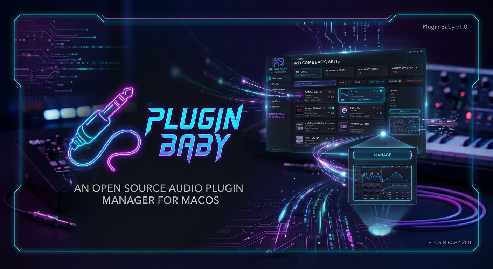

<p align="center">
  
</p>

# Plugin Baby

A local, personal macOS app for managing, auditioning, and organizing your audio
plugins. Built with SwiftUI + AppKit + AVFoundation. Everything stays on your Mac —
there is no account, no network, and no telemetry.

> The name is a nod to Muse's "Plug In Baby." The app's artwork and theme are original.

## What it does

**Catalog & search**
Scans both `~/Library/Audio/Plug-Ins` (User) and `/Library/Audio/Plug-Ins` (System)
for Audio Unit (`.component`), VST3, VST, and CLAP plugins. Shows name, manufacturer,
format, **where** it lives (User/System), version, architecture (Intel / Apple
Silicon / Universal), code-sign status, and size. Search and filter by format; reveal
any plugin in Finder.

**Audition**
Load an **Audio Unit** and hear it:
- **Effects** (`aufx`/`aumf`) process an audio sample you choose, with an A/B **bypass**
  toggle.
- **Instruments** (`aumu`) are played with a test MIDI note.
- **Open editor** shows the plugin's own interface in its own window, sized to the
  plugin's real UI.

**Chains / presets**
Group plugins into named, ordered chains with notes, saved locally.

**Archive / restore / delete**
Move a plugin out of its plugins folder into a local archive (recoverable), restore it
to its original location, or send it to the **Trash**. Archive-first: nothing is
destroyed without a recoverable copy. Archiving or restoring a **System** (`/Library`)
plugin prompts for admin rights via the standard macOS dialog; the archived copy is
handed back to your user account so later restore/delete need no further prompt.

## Build & run

```bash
./build.sh
open build/PluginBaby.app
```

`build.sh` compiles the Swift sources directly with `swiftc` and assembles a `.app`
bundle. It deliberately does **not** use SwiftPM: the standalone Command Line Tools on
the development machine ship a broken SwiftPM manifest library (`swift build` fails to
link the manifest). `Package.swift` is kept for when full **Xcode** is installed — then
you can open the package, build/run from Xcode, and raise the deployment target to
macOS 15 (Sequoia), the intended minimum.

**Requirements:** Xcode Command Line Tools (`xcode-select --install`). Builds for the
Mac's native architecture.

## App icon

The icon is generated from code (no bundled image assets):

```bash
./make-icon.sh    # Tools/MakeIcon.swift -> Resources/AppIcon.icns
```

## Where your data lives

Plugin Baby stores everything under one folder, picking the first writable location
from this list (so it still works if `~/Library/Application Support` is misconfigured):

1. `~/Library/Application Support/Plugin Baby/`
2. `~/Library/Plugin Baby/`
3. `~/.plugin-baby/`

```
<data folder>/
  chains.json             your chains
  archive/                archived plugin bundles
  archive-manifest.json   record of what's archived + where to restore it
  samples/                (reserved for saved audition samples)
```

## Project layout

```
Sources/PluginBaby/
  PluginBabyApp.swift        app entry
  AppModel.swift             central state + operations
  Theme.swift                colors, wordmark, brand gradient
  Models/                    Plugin, PluginFormat, PluginDomain, Architecture,
                             Chain, ArchiveEntry
  Services/
    PluginScanner.swift        filesystem scan (User + System) + lipo/codesign metadata
    AuditionEngine.swift       AVAudioEngine host for AU effects & instruments + editor
    AudioComponentDescriptionReader.swift   classify AU effect vs instrument
    ArchiveManager.swift       move / restore / trash with a manifest
    PrivilegedFileOps.swift    admin-authorized moves for /Library plugins
    Persistence.swift          JSON storage with writable-location fallback
    Shell.swift                run lipo/codesign/xattr
  Views/                     Catalog, Chains, Audition, Archive, ContentView
Tools/MakeIcon.swift         generates the app icon
Verify/main.swift            headless end-to-end check (scan + archive round-trip + render)
DESIGN.md                    design doc and locked decisions
```

## Notes & limits

- Live auditioning covers **Audio Units** (effects and instruments) and, newly,
  **CLAP** (effects and instruments) via a bundled C host shim — see
  `docs/CLAP-AUDITION.md`. CLAP is ABI-verified against a reference plugin but
  not yet tested against a commercial CLAP. VST3 hosting is still a later phase
  (`docs/VST3-AUDITION.md`).
- The app is **not sandboxed** (it must read and move files in the plugins folders), so
  it isn't an App Store candidate — fine for personal use.
- Universal binaries, code-sign status, and architecture are read with `lipo` and
  `codesign`.

## Roadmap

Done: catalog + search, chains, AU effect & instrument audition, plugin editor window,
archive/restore/delete, System-domain support with admin-authorized moves, original
electric theme and icon.

Candidates next (see "what commercial apps do" discussion): AU validation via `auval`,
crash-safe scanning, live metering/waveform in Audition, on-screen keyboard for
instruments, favorites/tags/categories, hosting a whole chain live.
